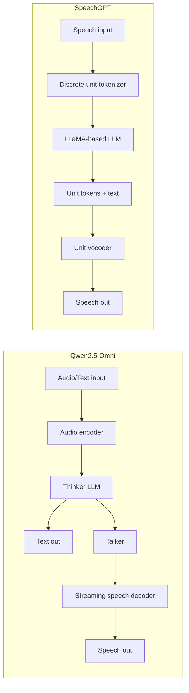

# Task 1 - Architecture Research Notes (TEMPLATE - verify every fact in the papers!)

Papers to read:
- Qwen2.5-Omni Technical Report (Qwen team, 2025) - search arXiv "Qwen2.5-Omni Technical Report"
- SpeechGPT: Empowering LLMs with Intrinsic Cross-Modal Conversational Abilities (Zhang et al., 2023)

## Quick background (my understanding - confirm in the papers)
| Aspect | Qwen2.5-Omni | SpeechGPT |
|---|---|---|
| Speech output? | Yes (streaming speech via "Talker") | Yes (via discrete units + vocoder) |
| Audio input representation | Audio encoder -> continuous features | Discrete speech units (HuBERT-style, k-means) |
| Core LLM | Qwen2.5 "Thinker" | LLaMA-based LLM |
| Speech generation | Talker generates speech tokens -> streaming decoder | LLM outputs unit tokens -> unit vocoder |
| Training idea | Multi-stage multimodal pretraining + post-training | 3 stages: modality-adaptation, cross-modal instruction tuning, chain-of-modality tuning |
| Streaming focus | Yes (block-wise processing) | Not a main focus |

## The seven required topics
The assignment lists 7 topics - paste them here and fill one row per topic for both models.
(Typical ones: audio encoder, LLM backbone, modality connector/representation, training stages,
speech decoder/generation, streaming/latency, Indic-language support & data.)

## Latency limitations to discuss
- Cascaded steps (encoder -> LLM -> speech decoder) add delay before first audio.
- Autoregressive generation of many audio tokens per second of speech.
- Discrete-unit approach: long unit sequences -> long LLM context.
- Little Indic training data -> accuracy drops, forcing larger models -> slower.

## Improvement idea (pick ONE and make it specific)
Example: "Language-aware early-exit / speculative decoding for Indic speech tokens: a small Indic-tuned
draft model proposes speech tokens, the large model verifies them in parallel to cut time-to-first-audio."
State: what changes, why it should reduce latency, how you would test it (metrics: RTF, time-to-first-token, WER).
Your Task 2 noise-reduction result can be used as small supporting evidence for the acoustic-robustness part.

## Diagram (Mermaid) - paste into https://mermaid.live to render

